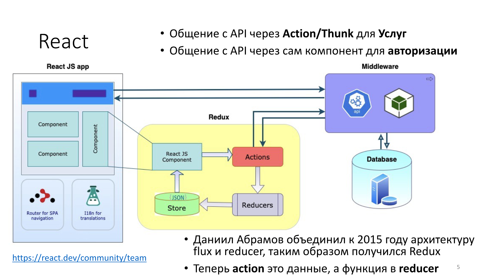
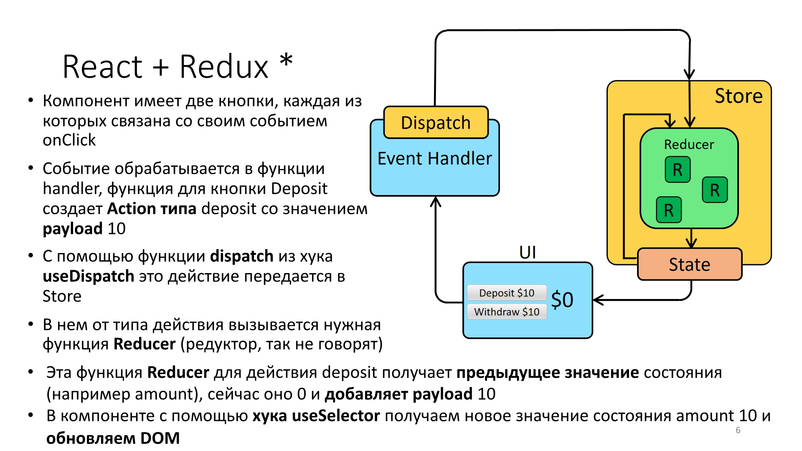
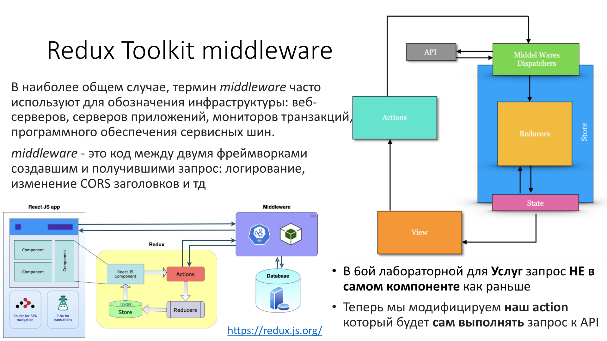
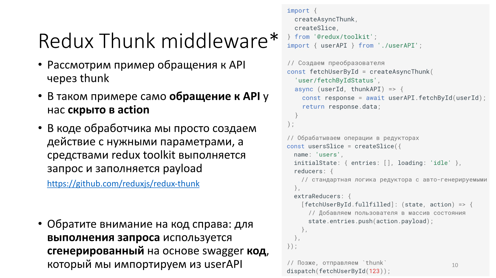

# Лабораторная работа №6 — ответы на контрольные вопросы

Тема: Labster — услуги «пары кислоты и щёлочи для титрования».
Фронтенд: React + TypeScript + Vite + Redux Toolkit. Бэкенд: NestJS (порт 3000), PostgreSQL, Redis (сессии), MinIO (файлы).

---

## 1. Схема Redux Toolkit

### 1.1. Из чего состоит Redux

| Элемент | Что это | Где в проекте |
|---|---|---|
| **Store** | единое хранилище состояния всего приложения | `src/store/index.ts` — `configureStore` |
| **State** | данные в хранилище | `{ user, filter, titration }` |
| **Slice** | часть хранилища: имя, начальное состояние, редьюсеры, действия | `userSlice.ts`, `filterSlice.ts`, `titrationSlice.ts` |
| **Action** | объект-событие `{ type, payload }`, это данные, а не функция | `{ type: 'user/setUser', payload: {...} }` |
| **Reducer** | функция `(state, action) → новое state`; только она меняет состояние | `setUser`, `resetFilter`, `extraReducers` |
| **dispatch** | отправляет action в store (хук `useDispatch`) | `dispatch(setUserAction(data))` |
| **Selector** | читает данные из store; компонент перерисовывается при их изменении (хук `useSelector`) | `useIsAuth()`, `useTitrationList()` |
| **Middleware** | функции между `dispatch` и reducer: логирование, ошибки, **асинхронные запросы к API** | redux-thunk (подключён `configureStore` по умолчанию) |
| **Thunk** | action-функция, которая сама выполняет запрос к API и потом отправляет обычные actions | `getTitrationPairsList`, `likeTitrationPair` и др. |

Хранилище и подключение (лекция 10, слайд 10):

```ts
// src/store/index.ts
export const store = configureStore({
  reducer: combineReducers({
    user: userReducer,          // авторизация
    filter: filterReducer,      // фильтр услуг
    titration: titrationReducer // услуги
  }),
})

// src/main.tsx
<Provider store={store}>
  <App />
</Provider>
```

### 1.2. Схема лекции 10: запрос к API в самом компоненте (авторизация)

В лекции 10 (слайды 5, 6, 14) компонент сам обращается к API через axios, а в Redux только передаёт результат.
В ЛР6 так сделана **авторизация**: только axios, без кодогенерации и thunk.

Лекция 10, слайд 5: общая архитектура React + Redux. Для услуг запрос к API идёт через Action/Thunk, для авторизации — через сам компонент.


Лекция 10, слайд 6: цикл Redux. Обработчик события → dispatch(action) → Store → Reducer → State → UI.


Та же схема для моего проекта, на примере входа:

```
 UI: страница «Вход», кнопка «Войти»  (src/pages/LoginPage.tsx)
   │  onSubmit
   ▼
 Event handler  handleSubmit
   │  1) axios.post('/api/titration_pairs/users/login', { username, password })
   │         └─▶ прокси Vite ─▶ NestJS: проверка пароля, сессия в Redis,
   │                               ответ 200 + заголовок Set-Cookie: sessionId (HttpOnly)
   │  2) dispatch(setUserAction(data))
   │         action = { type: 'user/setUser', payload: { id: 1, username: 'admin', ... } }
   ▼
 Store ──▶ Reducer  userSlice.setUser(state, { payload })
   │                 state.isAuth = true
   │                 state.username = payload.username
   ▼
 State  { user: { isAuth: true, username: 'admin' }, filter: {...}, titration: {...} }
   │  useSelector  →  useIsAuth()
   ▼
 UI перерисовывается: в меню «Выход» вместо «Вход», доступно «Добавление»,
 в ленте кнопка лайка, на плитке кнопки удаления своих услуг
```

Тот же цикл без API — **фильтр** (как «корзина без API» в лекции 10, слайды 11–13):

```
 Ползунок «Мин. концентрация» (ConcentrationFilter)
   │ onChange → dispatch(setMinConcentrationAction('0.15'))
   ▼
 Reducer filterSlice.setMinConcentration → state.filter.minConcentration = '0.15'
   ▼
 useMinConcentration() → ползунок и подпись показывают 0.15;
 значение сохраняется при переходе между страницами
```

Выход: `axios.post('/api/titration_pairs/users/logout')`, затем `dispatch(resetUserAction())` и `dispatch(resetFilterAction())`, так что интерфейс гостя и фильтр сбрасываются.

### 1.3. Схема лекции 11: запрос к API внутри action — thunk (услуги)

В лекции 11 (слайды 7–10) запрос **не в компоненте**: компонент только отправляет thunk,
а middleware redux-thunk выполняет запрос через **сгенерированный из swagger код** и заполняет payload.
В ЛР6 так сделаны все запросы домена **услуг**.

Лекция 11, слайд 7: Redux Toolkit middleware. Actions → Middleware (запрос к API) → Reducers → State → View.


Лекция 11, слайд 10: Redux Thunk middleware. Запрос к API скрыт в action (`createAsyncThunk`), результат приходит в `extraReducers`.


Та же схема для моего проекта, на примере загрузки плитки:

```
 View: «Плитка», кнопка «ОК»  (src/pages/GridPage.tsx)
   │  dispatch(getTitrationPairsList())          ← action-функция (thunk), а не объект
   ▼
 Middleware redux-thunk  (configureStore подключает его сам)
   │
   │ 1) dispatch({ type: 'titration/getTitrationPairsList/pending' })
   │       └─▶ reducer (addMatcher isPending): pendingRequests += 1
   │           → LoadingOverlay блокирует кнопки
   │
   │ 2) payloadCreator:
   │       const min = getState().filter.minConcentration         ← фильтр из Redux
   │       api.api.servicesControllerList({ minConcentration })   ← src/api/Api.ts (кодогенерация)
   │          └─▶ axios GET /api/titration_pairs?minConcentration=0.15
   │                └─▶ прокси Vite ─▶ NestJS ─▶ PostgreSQL
   │
   │ 3) успех:  dispatch({ type: '.../fulfilled', payload: [ {id, title, ...}, ... ] })
   │    ошибка: гость        → fulfilled с mock-коллекцией (src/modules/mock.ts)
   │            пользователь → dispatch({ type: '.../rejected', payload: 'Не удалось загрузить услуги' })
   ▼
 Reducers (extraReducers):  state.titration.list = payload
                            pendingRequests -= 1
   ▼
 State ─▶ useSelector: useTitrationList(), useTitrationLoading()
   ▼
 View: карточки перерисованы, анимация загрузки скрыта
```

Код thunk (`src/store/titrationSlice.ts`):

```ts
export const getTitrationPairsList = createAppAsyncThunk(
  'titration/getTitrationPairsList',
  async (_: void, { getState, rejectWithValue }) => {
    const { filter, user } = getState()
    const minConcentration = Number(filter.minConcentration)
    try {
      const { data } = await api.api.servicesControllerList(minConcentration > 0 ? { minConcentration } : {})
      return data as TitrationPair[]                       // → payload действия fulfilled
    } catch {
      if (user.isAuth) return rejectWithValue('Не удалось загрузить услуги')
      return TITRATION_PAIRS_MOCK.filter(/* ... */)         // гостю — mock
    }
  },
)

// в createSlice:
extraReducers: (builder) => {
  builder.addCase(getTitrationPairsList.fulfilled, (state, { payload }) => {
    state.list = payload
  })
}
```

Все thunk'и проекта:

| Thunk | Запрос | Сгенерированный метод |
|---|---|---|
| `getTitrationPairsList` | `GET /api/titration_pairs?minConcentration=` | `servicesControllerList` |
| `getFeedItem` | `GET /api/titration_pairs/feed`, `/feed/:id?next=true` | `servicesControllerFeed`, `servicesControllerFeedItem` |
| `getFeedIds` | `GET /api/titration_pairs` | `servicesControllerList` |
| `addTitrationPair` | `POST /api/titration_pairs`, затем `PUT /api/titration_pairs/:id` | `servicesControllerCreate`, `servicesControllerUpdate` |
| `deleteTitrationPair` | `DELETE /api/titration_pairs/:id` | `servicesControllerRemove` |
| `likeTitrationPair` | `POST /api/titration_pairs/:id/like` | `servicesControllerLike` |

### 1.4. Сравнение двух вариантов

| | Лекция 10 — запрос в компоненте | Лекция 11 — запрос в thunk |
|---|---|---|
| Где запрос | обработчик события в компоненте | action (thunk) внутри Redux |
| Чем | axios напрямую | сгенерированный клиент (axios внутри) |
| Что отправляется в store | обычный action с готовыми данными | thunk; middleware сам отправляет `pending` / `fulfilled` / `rejected` |
| Статус загрузки | вручную в компоненте (`useState`) | из `pending` / `fulfilled` в reducer |
| В ЛР6 | вход и выход | все методы услуг |

---

## 2. Axios

**Axios** — JavaScript-библиотека для HTTP-запросов на промисах (обещаниях). **fetch** — встроенный низкоуровневый интерфейс браузера.

Чем axios удобнее fetch (лекция 11, слайды 3–6):

| | fetch | axios |
|---|---|---|
| Ответ в JSON | нужно вызвать `response.json()` | сразу в `response.data` |
| Ошибки 4xx / 5xx | промис **не** отвергается, нужно проверять `response.ok` | промис отвергается, ошибка попадает в `catch` |
| POST с JSON | нужно `JSON.stringify` и заголовок `Content-Type` вручную | передаётся объект, остальное axios делает сам |
| Значения по умолчанию | нет, всё указывать в каждом запросе | `axios.defaults`, `axios.create({ baseURL, ... })` |
| Перехватчики | нет | `interceptors` для запросов и ответов |

### 2.1. Пример запроса с axios — вход (из проекта)

```ts
// src/pages/LoginPage.tsx
import axios, { isAxiosError } from 'axios'

const { data } = await axios.post<User>(
  '/api/titration_pairs/users/login',   // относительный адрес → прокси Vite → http://localhost:3000
  { username, password },              // объект, axios сам превратит его в JSON
)
// data = { id: 1, username: 'admin', role: 'moderator', created_at: '...' }
```

Обработка ошибки (axios отвергает промис при статусе 401 или 429):

```ts
} catch (err) {
  if (isAxiosError(err) && err.response?.status === 429) {
    // слишком много попыток входа
  }
}
```

### 2.2. Пример GET-запроса с параметрами

```ts
const response = await axios.get('/api/titration_pairs', {
  params: { minConcentration: 0.15 },   // → /api/titration_pairs?minConcentration=0.15
})
console.log(response.status) // 200
console.log(response.data)   // массив услуг
```

### 2.3. Axios в кодогенерации

Сгенерированный клиент `src/api/Api.ts` создаёт свой экземпляр axios:

```ts
import axios from "axios";

export class HttpClient<SecurityDataType = unknown> {
  public instance: AxiosInstance;
  constructor({ securityWorker, secure, format, ...axiosConfig }: ApiConfig<SecurityDataType> = {}) {
    this.instance = axios.create({ ...axiosConfig, baseURL: axiosConfig.baseURL || "" });
  }
}
```

Сгенерированный метод:

```ts
servicesControllerList: (query?: { minConcentration?: number }, params: RequestParams = {}) =>
  this.request<ListServiceDto[], void>({
    path: `/api/titration_pairs`,
    method: "GET",
    query: query,
    format: "json",
    ...params,
  }),
```

Генерация (`package.json`):

```json
"codegen": "swagger-typescript-api generate -p http://localhost:3000/api-json -o ./src/api -n Api.ts --axios --type-only-imports --enum-style=union"
```

---

## 3. Вызов метода аутентификации

### 3.1. Вход — `POST /api/titration_pairs/users/login`

```ts
// src/pages/LoginPage.tsx
const handleSubmit = async (event: FormEvent) => {
  event.preventDefault()
  setError('')
  setLoading(true)                                 // анимация, кнопка заблокирована
  try {
    const { data } = await axios.post<User>('/api/titration_pairs/users/login', { username, password })
    dispatch(setUserAction(data))                  // вручную передаём состояние в Redux
    setLoading(false)
    navigate(ROUTES.FEED)
  } catch (err) {
    setError(
      isAxiosError(err) && err.response?.status === 429
        ? 'Слишком много попыток, вход временно заблокирован'
        : 'Неверный логин или пароль',
    )
    setLoading(false)
  }
}
```

Что передаётся по сети:

```
POST http://localhost:3001/api/titration_pairs/users/login
Content-Type: application/json

{ "username": "admin", "password": "admin123" }

← 200 OK
Set-Cookie: sessionId=4767c899-...; Max-Age=3600; Path=/; HttpOnly; SameSite=Lax

{ "id": 1, "username": "admin", "role": "moderator", "created_at": "..." }
```

- Сервер создаёт сессию в Redis и ставит **HttpOnly-куку** `sessionId`. Из JavaScript её прочитать нельзя, это защита от кражи через XSS.
- Браузер сам отправляет эту куку во всех следующих запросах к `localhost:3001`, а прокси Vite передаёт её бэкенду. Поэтому лайки, удаление и добавление работают без дополнительного кода.
- В Redux хранится только признак интерфейса: `isAuth` и `username`. После F5 Redux сбрасывается, и приложение снова показывает интерфейс гостя, а кука остаётся (лекция 11, слайд 14: «по F5 либо пользователь пропадает, либо нужен повторный запрос login»).

### 3.2. Выход — `POST /api/titration_pairs/users/logout`

```ts
// src/components/BottomNav.tsx
const handleLogout = async () => {
  setLoading(true)
  try {
    await axios.post('/api/titration_pairs/users/logout')   // сервер удаляет сессию и куку
  } catch {
    // сессии на сервере уже нет — интерфейс всё равно переключается на гостя
  }
  dispatch(resetUserAction())     // интерфейс гостя
  dispatch(resetFilterAction())   // сброс фильтра пользователя
  setLoading(false)
}
```

### 3.3. Почему вход не через кодогенерацию

В сгенерированном клиенте метод входа есть:

```ts
usersControllerLogin: (data: LoginDto, params: RequestParams = {}) =>
  this.request<UserDto, void>({
    path: `/api/titration_pairs/users/login`,
    method: "POST",
    body: data,
    type: "application/json",
    format: "json",
    ...params,
  }),
```

В лекции 11 (слайд 13) вход показан через thunk: `fetchLogin = createAsyncThunk(..., () => api.authentificate.authentificateCreate(body))`.
По заданию ЛР6 для авторизации и деавторизации нужен **только axios**, а состояние передаётся в Redux **вручную, без кодогенерации и thunk**. Поэтому `usersControllerLogin` не используется.

---

## 4. Local Storage

**Local Storage** — хранилище «ключ → строка» в браузере.
- Своё у каждого origin (схема + домен + порт), объём около 5 МБ.
- Данные сохраняются после F5 и после закрытия браузера.
- Доступно из JavaScript: `localStorage.setItem('key', JSON.stringify(value))`, `getItem`, `removeItem`.
- Смотреть: DevTools → **Application** → Storage → Local Storage.

Похожие хранилища:

| | Local Storage | Session Storage | Cookie |
|---|---|---|---|
| Живёт | до удаления | до закрытия вкладки | до срока `Max-Age` / `Expires` |
| Уходит на сервер | нет | нет | да, автоматически с каждым запросом |
| Доступ из JS | да | да | да, но **не** для `HttpOnly` |

В курсе Local Storage используется только для хранения **JWT** (лекция 11, слайд 14), остальное состояние в нём не хранят.
В моём проекте JWT нет: авторизация через **сессию**, `sessionId` лежит в HttpOnly-куке. Поэтому Local Storage пустой, а кука видна в Application → Cookies.

---

## 5. CORS и обратный прокси

**Same-origin policy** — браузер не даёт JavaScript-коду читать ответы от другого **origin** (схема + домен + порт).
`http://localhost:3001` (фронтенд) и `http://localhost:3000` (бэкенд) — разные origin, потому что разные порты.

**CORS** (Cross-Origin Resource Sharing) — способ, которым сервер разрешает запросы с другого origin через заголовки ответа:
- `Access-Control-Allow-Origin: http://localhost:3001` — какому origin можно;
- `Access-Control-Allow-Credentials: true` — можно отправлять куки;
- `Access-Control-Allow-Methods`, `Access-Control-Allow-Headers`.

Для «непростых» запросов (PUT, DELETE, JSON-тело) браузер сначала отправляет **preflight-запрос** `OPTIONS` и выполняет основной запрос, только если сервер разрешил.
На бэкенде CORS включён через `app.enableCors({ origin, credentials: true })`.

**Обратный прокси** (reverse proxy) — сервер, который стоит перед бэкендом и пересылает ему запросы клиентов.
Браузер обращается к **своему** origin, поэтому CORS не нужен. Прямой прокси (forward proxy) работает наоборот: стоит на стороне клиента и ходит в интернет за него.

В проекте обратный прокси — dev-сервер Vite (`vite.config.ts`):

```ts
proxy: {
  '/api':   { target: 'http://localhost:3000', changeOrigin: true },        // веб-сервис
  '/minio': { target: 'http://localhost:9000', changeOrigin: true,          // S3 (MinIO)
              rewrite: (path) => path.replace(/^\/minio/, '') },
}
```

```
Браузер ──▶ http://localhost:3001/api/titration_pairs ──▶ Vite ──▶ http://localhost:3000/api/titration_pairs
Браузер ──▶ http://localhost:3001/minio/titration/image6.jpg ──▶ Vite ──▶ http://localhost:9000/titration/image6.jpg
```

В продакшене ту же роль обычно играет **nginx**.

---

## 6. BFF и GraphQL

**BFF (Backend for Frontend)** — отдельный серверный слой под конкретный клиент: веб, мобильное приложение и т. д.
- Собирает данные из нескольких микросервисов в один ответ, нужный именно этому экрану.
- Убирает лишние поля, приводит формат к удобному для клиента.
- Может хранить сессию и токены на сервере, чтобы они не попадали в браузер.
- Пример: мобильному приложению нужен облегчённый ответ, а веб-версии подробный, поэтому у каждого свой BFF.

**GraphQL** — язык запросов к API и среда его выполнения (разработан в Facebook).
- Обычно **один эндпоинт** (`POST /graphql`) вместо многих REST-адресов.
- Клиент сам указывает, какие поля ему нужны. Нет лишних данных (over-fetching) и не нужно делать несколько запросов (under-fetching).
- Строго типизированная **схема**; операции: `query` (чтение), `mutation` (изменение), `subscription` (подписка на события).

Пример запроса для моей предметной области:

```graphql
query {
  titrationPairs(minConcentration: 0.1) {
    id
    title
    ph
    likesCount
  }
}
```

GraphQL часто используют **как BFF**: один GraphQL-сервер для фронтенда собирает данные из нескольких REST-сервисов.

---

## 7. Next.js и SSG

**Next.js** — фреймворк на основе React (компания Vercel): маршрутизация по файлам, серверный рендеринг, API-маршруты, оптимизация изображений.

Способы рендеринга:

| Способ | Когда строится HTML | Пример |
|---|---|---|
| **CSR** (Client-Side Rendering) | в браузере, из JavaScript | мой проект на Vite: сервер отдаёт пустой `index.html` и JS |
| **SSR** (Server-Side Rendering) | на сервере **при каждом запросе** | ЛР3: страницы на NestJS + handlebars |
| **SSG** (Static Site Generation) | **один раз при сборке** (`next build`) | документация, блог, лендинг |
| **ISR** (Incremental Static Regeneration) | при сборке и затем периодически пересобирается | каталог, который меняется раз в несколько минут |

**SSG**: страницы превращаются в готовые HTML-файлы при сборке. Их можно раздавать с CDN, поэтому они загружаются очень быстро и хорошо индексируются поисковиками (SEO).
После загрузки React «оживляет» страницу (**гидратация**).
Подходит для данных, которые редко меняются. Для персональных данных (лайки, «мои услуги») нужен SSR или CSR.

В Next.js: в Pages Router — `getStaticProps` / `getStaticPaths`, в App Router страницы статические по умолчанию, параметры задаёт `generateStaticParams`, а для ISR указывается `revalidate`.

---

## 8. FSD (Feature-Sliced Design)

**FSD** — методология организации кода фронтенда по слоям, срезам и сегментам.

**Слои** (сверху вниз). Модуль может импортировать только из слоёв **ниже**:

| Слой | Назначение | Пример для моего проекта |
|---|---|---|
| `app` | инициализация: провайдеры, роутинг, стили, store | `main.tsx`, `App.tsx`, `store/index.ts` |
| `pages` | страницы целиком | `FeedPage`, `GridPage`, `AddPage`, `LoginPage` |
| `widgets` | крупные самостоятельные блоки | `BottomNav` (нижнее меню) |
| `features` | действия пользователя, которые приносят ценность | вход/выход, лайк, удаление, фильтр по концентрации, добавление |
| `entities` | бизнес-сущности | `titration-pair` (карточка, тип, slice), `user` |
| `shared` | переиспользуемое без бизнес-логики | `api/Api.ts` (кодогенерация), `LoadingOverlay`, `minioUrl` |

(Слой `processes` в новых версиях FSD устарел.)

**Срезы (slices)** делят слой по предметной области: `entities/titration-pair`, `entities/user`, `features/like-titration-pair`.

**Сегменты** делят срез по назначению: `ui` (компоненты), `model` (Redux slice, thunk), `api` (запросы), `lib` (вспомогательные функции), `config`.

**Public API**: каждый срез отдаёт наружу только то, что объявлено в его `index.ts`. Импортировать внутренние файлы чужого среза нельзя.

Пример структуры, если перевести проект на FSD:

```
src/
  app/            store, App.tsx, провайдеры
  pages/          feed/, grid/, add/, login/
  widgets/        bottom-nav/
  features/       auth/, like-titration-pair/, delete-titration-pair/, filter-by-concentration/
  entities/       titration-pair/ (ui/TitrationCard, model/titrationSlice), user/ (model/userSlice)
  shared/         api/ (Api.ts), ui/ (LoadingOverlay), lib/ (minioUrl)
```

Сейчас проект устроен проще, по типам файлов: `pages/`, `components/`, `store/`, `api/`, `modules/`.
